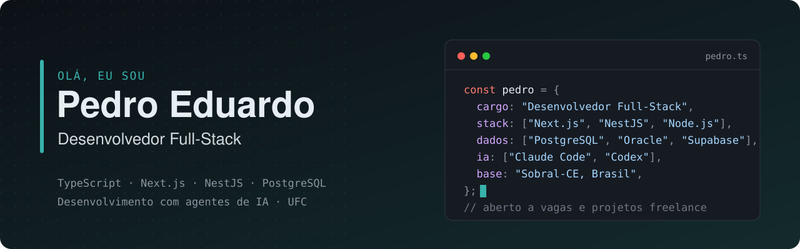

<picture>
  <source media="(prefers-color-scheme: dark)" srcset="./assets/banner-dark.svg">
  <source media="(prefers-color-scheme: light)" srcset="./assets/banner-light.svg">
  
</picture>

  
  
  
  
  

---

### 👋 Sobre mim

Sou desenvolvedor full-stack e trabalho com **agentes de IA no dia a dia**: eles escrevem e revisam código comigo, e eu cuido do que não dá para delegar (escopo, arquitetura, revisão do diff, merge e produção).

Comecei na TI pelo suporte e pela rede. Como **Analista de TI em uma distribuidora**, sustentei o ERP **TOTVS WinThor**, escrevi consultas em **Oracle** e **MySQL** para relatórios de gestão e desenvolvi aplicações internas em **React** e **Node.js** ligando os dados do ERP às regras do negócio. Hoje faço sistemas web completos com **TypeScript, Next.js, NestJS e PostgreSQL**, para empregadores e clientes freelance.

- 🎓 Engenharia de Computação na **UFC** (conclusão prevista para 2027)
- 📚 Formação full-stack de **1.500 horas** pela **Trybe**
- 💼 Aberto a vagas de desenvolvimento e a projetos freelance

---

### 🤖 Desenvolvimento com IA

No [OTILC Store](https://github.com/devpedroeduardo/otilc-store), um e-commerce real com Pix, montei e coordeno um **time de agentes de IA** que trabalha por especificação:

| Papel | Quem | O que faz |
|---|---|---|
| Product Owner | eu | prioridade, escopo, revisão final, merge, produção e segredos |
| Orquestrador | Claude | transforma o pedido em spec, distribui e consolida |
| Devs | Claude Code | back-end, banco e segurança; front-end e docs |
| Revisor | Codex (OpenAI) | revisa todo PR em modo só leitura, de outro fornecedor que o autor |
| CI/CD | modelo leve | vigia o CI, faz a triagem de logs e levanta fatos do repositório |

- **Spec antes de código:** cada mudança nasce de uma spec com critérios de aceite ([37 até agora](https://github.com/devpedroeduardo/otilc-store/tree/main/specs)) e vira um PR revisado. São 50+ PRs mergeados.
- **Regras versionadas:** [`AGENTS.md`](https://github.com/devpedroeduardo/otilc-store/blob/main/AGENTS.md), papéis, roteamento e scorecard em [`docs/agents`](https://github.com/devpedroeduardo/otilc-store/tree/main/docs/agents). Quem executa e quem revisa cada tipo de tarefa se decide por evidência, não por impressão.
- **Rede de segurança:** CI com testes unitários, integração com Postgres real, E2E com Playwright, Semgrep, gitleaks e auditoria de dependências. Agente nenhum faz merge.
- **IA dentro do produto:** no [MyFinPocket](https://github.com/devpedroeduardo/my-finpocket), o Gemini lê a foto de um comprovante e preenche a transação, e gera uma análise dos gastos do mês.

---

### 🚀 Projetos em destaque

<table>
  <tr>
    <td width="50%" valign="top">
      <h4>🛒 <a href="https://github.com/devpedroeduardo/otilc-store">OTILC Store</a></h4>
      
E-commerce de uma marca de streetwear, feito para um cliente real. Monorepo com API, loja e painel administrativo.

      <ul>
        <li>Estoque à prova de concorrência: 10 compras simultâneas da última peça, só uma passa</li>
        <li>Pix com Mercado Pago: webhook assinado e conciliação com <code>FOR UPDATE SKIP LOCKED</code></li>
        <li>Painel admin com login por cookie httpOnly e permissões por papel</li>
        <li>Construído com um time de agentes de IA, spec a spec</li>
      </ul>
      

        
        
        
        
      

    </td>
    <td width="50%" valign="top">
      <h4>💰 <a href="https://github.com/devpedroeduardo/my-finpocket">MyFinPocket</a></h4>
      
Finanças pessoais instalável como app (PWA), com leitura de comprovantes por IA.

      <ul>
        <li>Gemini preenche a transação a partir da foto da nota</li>
        <li>Row Level Security no Supabase e rotas protegidas por middleware</li>
        <li>Jest e Playwright rodando no CI a cada push</li>
      </ul>
      

        
        
        
        
      

      
<a href="https://my-finpocket.vercel.app/"><b>Ver online »</b></a>

    </td>
  </tr>
  <tr>
    <td width="50%" valign="top">
      <h4>🏷️ <a href="https://github.com/devpedroeduardo/otilc-landing">OTILC Pré-venda</a></h4>
      
Vitrine que validou a marca antes da loja: site estático, sem build, pedidos pelo WhatsApp.

      <ul>
        <li>Lighthouse 98 a 100</li>
        <li>Testes E2E e de acessibilidade</li>
      </ul>
      
<a href="https://devpedroeduardo.github.io/otilc-landing/"><b>Ver online »</b></a>

    </td>
    <td width="50%" valign="top">
      <h4>🛠️ <a href="https://github.com/devpedroeduardo/neo-estech-project">NEO Estech</a></h4>
      
Desafio técnico de front-end: gestão de chamados operacionais.

      <ul>
        <li>Next.js, Ant Design, React Query e Zod</li>
        <li>Testes com Vitest e Playwright</li>
      </ul>
      
<a href="https://neo-estech-project.vercel.app/"><b>Ver online »</b></a>

    </td>
  </tr>
</table>

---

### 🛠️ Tecnologias

| Área | Ferramentas |
|---|---|
| **Front-end** |      |
| **Back-end** |        |
| **Banco de dados** |      |
| **IA** |     |
| **Testes** |     |
| **DevOps e ferramentas** |      |
| **Sistemas** |  |

---

### 🗺️ Trajetória

| Período | |
|---|---|
| **2025 a 2026** | **Analista de TI** · Distribuidora Donizete: ERP WinThor, Oracle/MySQL, aplicações internas em React e Node.js |
| **2021 a 2022** | **Estagiário de TI e Redes** · Rações Golfinho: suporte, rede local e estações de trabalho |
| **2020 a 2021** | **Desenvolvimento Web Full-Stack** · Trybe, 1.500 horas |
| **2019 a hoje** | **Engenharia de Computação** · Universidade Federal do Ceará |

Vamos conversar? <a href="mailto:pedroedu77@gmail.com">pedroedu77@gmail.com</a> · <a href="https://www.linkedin.com/in/devpedroeduardo/">LinkedIn</a>

